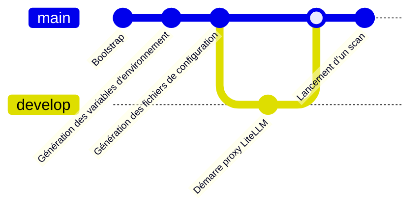

# PALA — Pentest agentique, Lab ANSSI

PALA est une suite d'**outils d'audit de sécurité pilotés par des agents LLM**, sur une
cible fournie par l'utilisateur, avec des **modèles souverains** (Albert — DINUM, Scaleway).

Le dépôt ne contient aucun résultat d'audit : il fournit l'outillage, les configurations d'exemple et
la méthode. Les cibles, les identifiants et les sorties de scan ne sont jamais versionnés.

## Les outils

| Outil                                                               | Rôle                                                                                     | Nature                        |
| ------------------------------------------------------------------- | ---------------------------------------------------------------------------------------- | ----------------------------- |
| [Codex Security](https://github.com/openai/codex-security) (OpenAI) | Analyse statique de code agentique : repère des faiblesses potentielles et les documente | Lit le code, hors ligne       |
| [Shannon](https://github.com/KeygraphHQ/shannon) (Keygraph)         | Pentest agentique dynamique sur une application en marche                                | Agit sur une instance vivante |

Les deux s'enchaînent : **Codex Security d'abord** (analyse statique, large et bon marché), puis
**Shannon** (validation dynamique, ponctuelle) sur les points qui méritent une preuve.

Chaque outil est branché sur un modèle via une API compatible **Chat Completions**. Pour Codex
Security, qui ne parle que l'API _Responses_, un **proxy LiteLLM local** fait la traduction et
garde la clé du fournisseur hors de l'environnement de l'agent (voir
[documentation Codex](outils/codex-security/README.md) de PALA).

## Démarrage

Prérequis : Node.js 24.22.1 (version épinglée dans `.nvmrc`), Python ≥ 3.10, Docker. Les modèles sont fournis par un fournisseur
compatible OpenAI (Albert ou Scaleway).

Il existe une CLI déclinée en bash et en Node. Les commandes fournies utilisent la CLI Node

### Cinématique



#### Préparation / bootstrap d’une cible

Le bootstrap consiste à préparer les sous-modules (tirer Codex et Shannon) et cloner une cible arbitraire dans `cible/copies/<nom>`.
L’installation de Codex et Shannon se fait une seule fois sur l’hôte. Tout nouvel appel au bootstrap pour une nouvelle cible va tirer le repo Git de la cible dans `cible/copies/<nom>`.

```bash
cp .env.example .env            # renseigner les variables
# préparer les sous-modules et cloner une cible arbitraire dans cible/copies/<nom> :
pnpm run bootstrap --project <nom> --url <url git>
pnpm run génère-env
```

La configuration du fournisseur se fait par les variables `FOURNISSEUR_*` du `.env` racine :

- [Albert](documentation/albert-api.md)
- [Scaleway](documentation/scaleway-ai-api.md)

#### Génération de la configuration

La configuration d’un scan est générée à partir du `.env` racine et de la cible, un fichier `config-<cible>.yaml` va être créé dans `outils/codex-security/configs`.

La configuration créée prend en compte un pull du repo de la cible pour le mettre à jour et la génération des fichiers à scanner en répertoriant les fichiers modifiés sur 7 jours glissants (par défaut, il est possible de fournir une autre valeur)

```bash
pnpm run génère-config --help
pnpm run génère-config --cible <nom>
```

#### Lancer une évaluation

**⚠️ Préconisation pour les scans :**

Éviter de lancer un scan sur l’intégralité d’un repo github, sauf si le repo est très petit :

- Une analyse demande du temps et consomme beaucoup de ressources et de tokens.
- Un dépot ou un répertoire trop volumineux peut entraîner des résultats incomplets voir incohérents
  (plus le contexte grossi, plus le modèle et le raisonnement deviennent complexes et sujets à erreurs).
- Il est préférable de scanner des fichiers individuels ou des répertoires spécifiques.

1. **Analyse statique** avec Codex Security : `pnpm démarre-proxy`, puis `pnpm scan` (dépôt entier)
   ```bash
   pnpm démarre-proxy
   pnpm scan --cible $PWD/cible/copies/<cible> --config $PWD/outils/codex-security/configs/config-<cible>.yaml
   ```
   Un compte rendu simple du scan est publié sur le webhook Mattermost (à renseigner dans le `.env` racine)
   La confrontation d'un point précis au code se fait avec `pnpm validate`.
2. **Validation dynamique** avec Shannon : une instance **jetable** de la cible doit tourner en
   local (base de données jetable, données de test). `pnpm shannon` lance le pentest ; les
   configurations par intention (analyse, authentifié, création de compte, focus, SAST) sont dans
   `outils/shannon/configs/`.

Détails par outil :

- [Codex Security](outils/codex-security/README.md),
- [Shannon](outils/shannon/README.md).
- [Méthode d'ensemble](documentation/demarche.md).

#### Effectuer un scan complet

⚠️ Renseigner le `.env` racine est indispensable pour lancer un scan complet.

La commande `pnpm run scan-complet --project <nom> --url <url-git>` permet de lancer toutes les étapes précédentes en une seule fois.

## Structure

```
outils/<outil>/        source/ (sous-module amont), configs, README (voir documentation/ajouter-un-outil.md)
outillage/javascript/  outillage TypeScript (Node 24.22.1, vitest, architecture hexagonale)
documentation/         démarche, notes API fournisseurs, versions
cible/                 copies locales des cibles (jamais versionnées)
```

## Sécurité et précautions

- **Aucune cible, aucun identifiant, aucune sortie de scan n'est versionné** (voir `.gitignore`).
  Les secrets vivent dans `.env` (non suivi) ; seuls les modèles `*.template.*` sont versionnés.
- Shannon agit réellement sur l'application en mode exploitation (écritures, comptes, e-mails) :
  **toujours une instance et une base jetables**, jamais un environnement de production.
- Le bac à sable de Codex Security a un accès en lecture au disque : ne pas le lancer sur une
  machine portant d'autres secrets.
