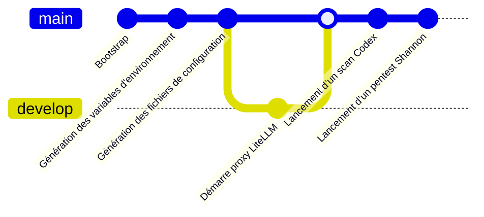

# PALA — Pentest agentique, Lab ANSSI

## Présentation

**PALA** est une **expérimentation du Lab ANSSI** mettant à disposition des **outils d'audit de sécurité pilotés par des agents LLM**, sur une
cible fournie par l'utilisateur.

Le but d’un tel outil est de mettre à disposition des leviers d’aide à la sécurisation de ses applications :

- en utilisant des LLM de génération et d’assistance de code
- en utilisant des agents spécialisés dans la sécurité
- en effectuant une analyse alliant la découverte, la preuve et la correction
- tout cela sur des bases de code évoluant quotidiennement

## Documentation

La documentation de référence est organisée dans le répertoire [`documentation/`](documentation/README.md).

Les instructions destinées aux agents de développement sont organisées dans [`.agents/skills/`](.agents/skills/README.md).

Le fichier [`AGENTS.md`](AGENTS.md) constitue le point d'entrée commun des agents de code.

## Stack technique

- Runtime : Node.js
- Langage : TypeScript
- Frontend : Svelte
- Backend : Express
- CLI : TypeScript
- Base de données : PostgreSQL (Knex)
- Environnement de développement : Docker

Versions et détail : [`documentation/technical/stack.md`](documentation/technical/stack.md).

## Démarrage rapide

Prérequis : Node.js (version épinglée dans `.nvmrc`), pnpm, Python ≥ 3.10, Docker. Les modèles sont fournis par un fournisseur
compatible OpenAI.

Renseigner le `.env` en se basant sur `.env.example`.

```bash
pnpm install # Installe les dépendances du projet et de ses paquets

docker network create reseau-pala # Une seule fois : réseau partagé par les conteneurs
./scripts/dev/start.sh # Construit les images docker et les démarre

pnpm run test # Lance les tests
pnpm run typecheck # Vérifie le typage
pnpm run lint # Analyse le code
pnpm run format:corrige # Corrige les fichiers en suivant les conventions de codage
```

Le détail de l'installation est dans [`documentation/development/getting-started.md`](documentation/development/getting-started.md).

## Démarrage

L’outil dispose d’une CLI dont les commandes sont détaillées ci-dessous.

### Cinématique



#### Préparation / bootstrap d’une cible

Le bootstrap consiste à préparer les sous-modules (tirer Codex et Shannon) et cloner une cible arbitraire dans `cible/copies/<nom>`.
L’installation de Codex et Shannon se fait une seule fois sur l’hôte. Tout nouvel appel au bootstrap pour une nouvelle cible va tirer le repo Git de la cible dans `cible/copies/<nom>`.

```bash
cp .env.example .env            # renseigner les variables
# préparer les sous-modules et cloner une cible arbitraire dans cible/copies/<nom> :
pnpm run pala:bootstrap --project <nom> --url <url git>
pnpm run pala:génère-env
```

La configuration du fournisseur se fait par les variables `FOURNISSEUR_*` du `.env` racine (une configuration est embarquée pour Albert) :

```text
FOURNISSEUR_NOM=albert,
FOURNISSEUR_BASE_URL=<url Albert>,
FOURNISSEUR_API_KEY=<clé Albert>
```

#### Génération de la configuration

La configuration d’un scan est générée à partir du `.env` racine et de la cible, un fichier `config-<cible>.yaml` va être créé dans `outils/codex-security/configs`.

La configuration créée prend en compte un pull du repo de la cible pour le mettre à jour et la génération des fichiers à scanner en répertoriant les fichiers modifiés sur 7 jours glissants (par défaut, il est possible de fournir une autre valeur)

```bash
pnpm run pala:génère-config --help
pnpm run pala:génère-config --cible <nom>
```

#### Lancer une évaluation

**⚠️ Préconisation pour les scans :**

Éviter de lancer un scan sur l’intégralité d’un repo github, sauf si le repo est très petit :

- Une analyse demande du temps et consomme beaucoup de ressources et de tokens.
- Un dépot ou un répertoire trop volumineux peut entraîner des résultats incomplets voir incohérents
  (plus le contexte grossi, plus le modèle et le raisonnement deviennent complexes et sujets à erreurs).
- Il est préférable de scanner des fichiers individuels ou des répertoires spécifiques.

1. **Analyse statique** avec Codex Security : `pnpm codex:démarre-proxy`, puis `pnpm codex:scan`
   ```bash
   pnpm codex:démarre-proxy
   pnpm codex:scan --cible $PWD/cible/copies/<cible> --config $PWD/outils/codex-security/configs/config-<cible>.yaml
   ```
   Un compte rendu simple du scan est publié sur le webhook Mattermost (à renseigner dans le `.env` racine)
   La confrontation d'un point précis au code se fait avec `pnpm codex:validate`.
2. **Validation dynamique** avec Shannon : une instance **jetable** de la cible doit tourner en
   local (base de données jetable, données de test). `pnpm shannon:pen-test` lance le pentest ; les
   configurations par intention (analyse, authentifié, création de compte, focus, SAST) sont dans
   `outils/shannon/configs/`.

Détails par outil :

- [Codex Security](outils/codex-security/README.md),
- [Shannon](outils/shannon/README.md).
- [Méthode d'ensemble](documentation/demarche.md).

#### Effectuer un scan complet

⚠️ Renseigner le `.env` racine est indispensable pour lancer un scan complet.

La commande `pnpm run codex:scan-complet --cible <url-git>` permet de lancer toutes les étapes précédentes en une seule fois.

## Structure

Le dépôt est un **workspace pnpm** : quatre paquets (`pala-back`, `pala-front`, `pala-outillage`,
`pala-noyau-partage`) et une racine qui porte l'outillage de dev partagé (TypeScript, vitest, prettier, tsx) et les
scripts de lancement.

```
serveur/back/          workspace « pala-back » : serveur Express (sert la SPA, protection CSP/rate-limit)
serveur/front/         workspace « pala-front » : SPA Svelte 5 au design system de l'État
outillage/             workspace « pala-outillage » : CLI TypeScript d'audit (vitest, archi hexagonale)
noyau-partage/         workspace « pala-noyau-partage » : chiffrement, entrepôts et migrations communs à la CLI et au serveur
outils/<outil>/        source/ (sous-module amont), configs, README (voir documentation/ajouter-un-outil.md)
documentation/         documentation de référence : projet, architecture, technique, développement, qualité, métier
.agents/skills/        skills destinées aux agents de code
scripts/               démarrage local, hooks Clever Cloud, tâche planifiée de scan
cible/                 copies locales des cibles (jamais versionnées)
```

## Sécurité et précautions

- **Aucune cible, aucun identifiant, aucune sortie de scan n'est versionné** (voir `.gitignore`).
  Les secrets vivent dans `.env` (non suivi) ; seuls les modèles (`.env.example`, `*.template.*`) sont versionnés.
- Shannon agit réellement sur l'application en mode exploitation (écritures, comptes, e-mails) :
  **toujours une instance et une base jetables**, jamais un environnement de production.
- Le bac à sable de Codex Security a un accès en lecture au disque : ne pas le lancer sur une
  machine portant d'autres secrets.
