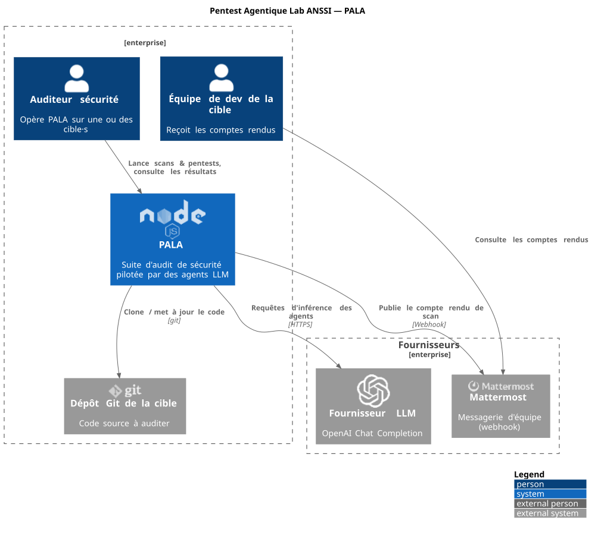
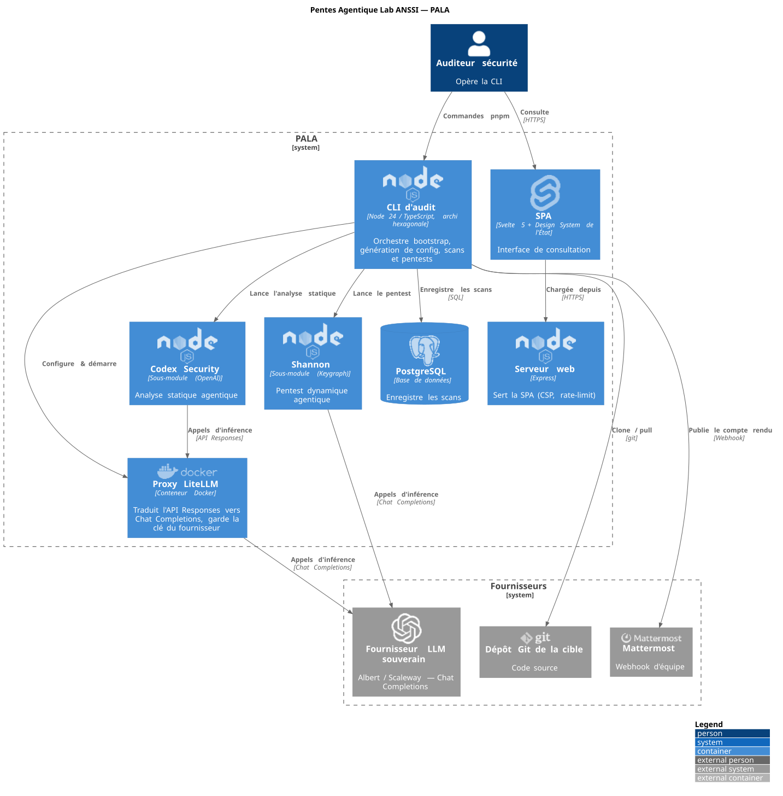
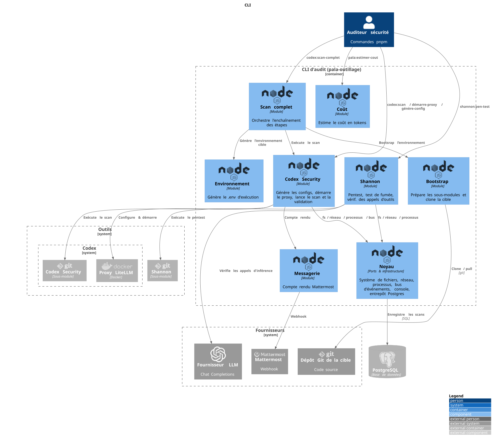

# Architecture

Vue de l'architecture selon le [modèle C4](https://c4model.com/) des 3 premiers niveaux. Les diagrammes sont décrits dans
[`documentation/architecture-c4.puml`](./architecture-c4.puml).

## Régénérer les images du modèle C4

```bash
 docker run --rm -v "$PWD/documentation":/work plantuml/plantuml \
   -tsvg -o /work /work/architecture-c4.puml
```

## Niveau 1 — Contexte



## Niveau 2 — Conteneurs



## Niveau 3 — Composants (conteneur « CLI d'audit »)

Décomposition du conteneur `pala-outillage`, organisé par domaines en architecture hexagonale.


