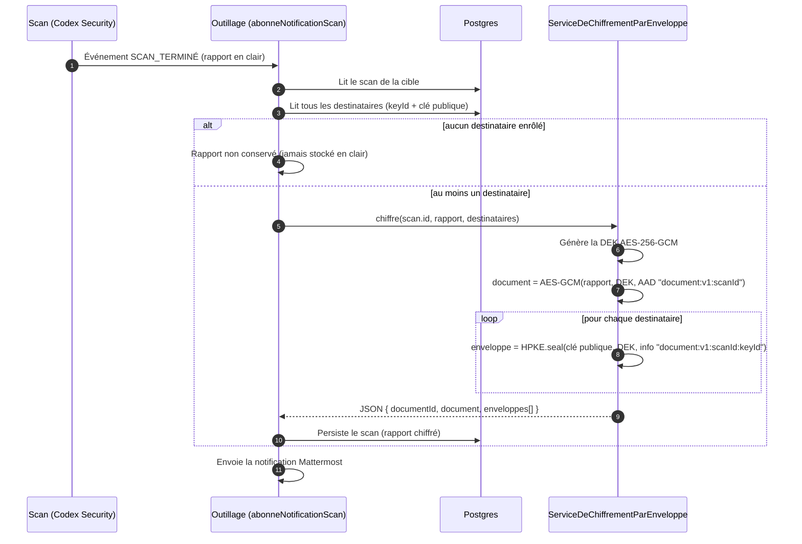

# Chiffrement du rapport

À la fin d'un scan, l'outillage chiffre le rapport par enveloppe : une clé de données (DEK) aléatoire chiffre le rapport, puis cette DEK est encapsulée séparément pour chaque destinataire avec HPKE (clé publique X25519).

Le JSON persisté contient le document chiffré (`iv`, `ciphertext`) et une enveloppe par destinataire (`keyId`, `enc`, `ciphertext`), le tout en base64url. La DEK n'est jamais stockée en clair.

## Qui peut déchiffrer ?

- **Les destinataires présents en base au moment de la fin du scan**, et eux seuls : chacun possède une enveloppe qui n'est ouvrable qu'avec sa propre clé privée.
- **Une personne enrôlée après le scan** n'a pas d'enveloppe : elle ne peut pas lire ce rapport.
- **L'outillage** connaît le rapport en clair au moment du chiffrement, puis ne conserve que la version chiffrée. Il ne détient que des clés publiques et ne peut pas relire un rapport déjà stocké.
- **Le serveur et la base** voient des données chiffrées et des enveloppes : ni la DEK ni les clés privées déverrouillées n'y figurent.
- Les contextes (AAD du document, `info` HPKE de l'enveloppe) lient chaque enveloppe à un rapport et à une clé : une enveloppe copiée sur un autre rapport ne s'ouvre pas.

## Code

- Service : [`noyau-partage/src/chiffrement/application/serviceDeChiffrementParEnveloppe.ts`](../../noyau-partage/src/chiffrement/application/serviceDeChiffrementParEnveloppe.ts)
- Contextes AAD et `info` : [`noyau-partage/src/chiffrement/domaine/profilEncapsulationChiffrementUtilisateur.ts`](../../noyau-partage/src/chiffrement/domaine/profilEncapsulationChiffrementUtilisateur.ts)
- Branchement dans la notification : [`outillage/src/composition/notificationScan.ts`](../../outillage/src/composition/notificationScan.ts)
