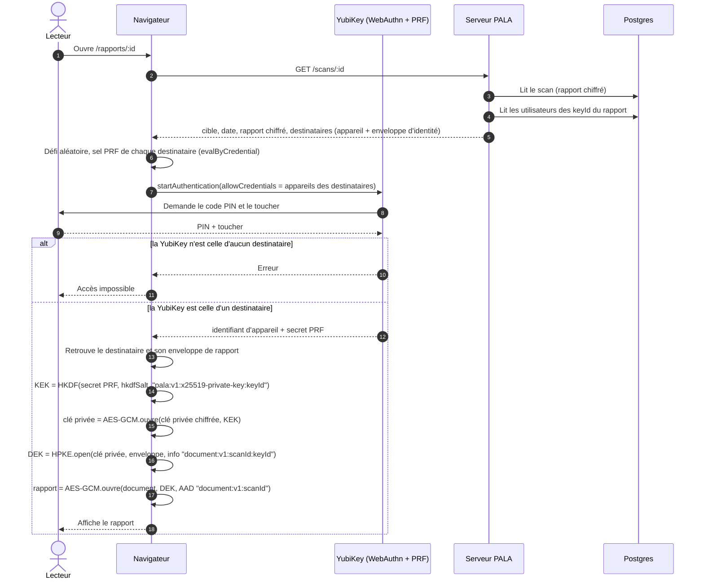

# Déchiffrement du rapport

Le déchiffrement se fait uniquement dans le navigateur de la personne destinataire, avec sa YubiKey. Le serveur ne fait que transmettre le rapport chiffré et les enveloppes.

Le secret PRF, la clé privée et la DEK n'existent qu'en mémoire du navigateur, le temps de la lecture. Rien n'est renvoyé au serveur.

## Qui peut déchiffrer ?

Il faut réunir trois conditions :

1. avoir été enrôlé **avant** la fin du scan, pour disposer d'une enveloppe dans le rapport ;
2. posséder la YubiKey enregistrée lors de l'enrôlement ;
3. fournir son code PIN et un geste de présence.

Ne peuvent pas déchiffrer :

- le serveur, la base de données et l'outillage : aucun ne détient de clé privée déverrouillable ;
- une personne enrôlée après le scan ;
- quelqu'un qui connaît l'URL du rapport mais n'a pas de YubiKey destinataire : la route renvoie les données chiffrées, qui restent illisibles.

Les trois pages se lisent dans l'ordre : [enrôlement](./enrolement.md), [chiffrement](./chiffrement.md), déchiffrement.

## Code

- Étapes côté navigateur : [`serveur/front/src/rapport/etapesDechiffrement.ts`](../../serveur/front/src/rapport/etapesDechiffrement.ts)
- Cas d'usage : [`DeverrouilleClePrivee`](../../noyau-partage/src/chiffrement/application/DeverrouilleClePrivee.ts) et [`DechiffreDocument`](../../noyau-partage/src/chiffrement/application/DechiffreDocument.ts)
- Ressource serveur : [`serveur/back/src/http/routeScans.ts`](../../serveur/back/src/http/routeScans.ts)
