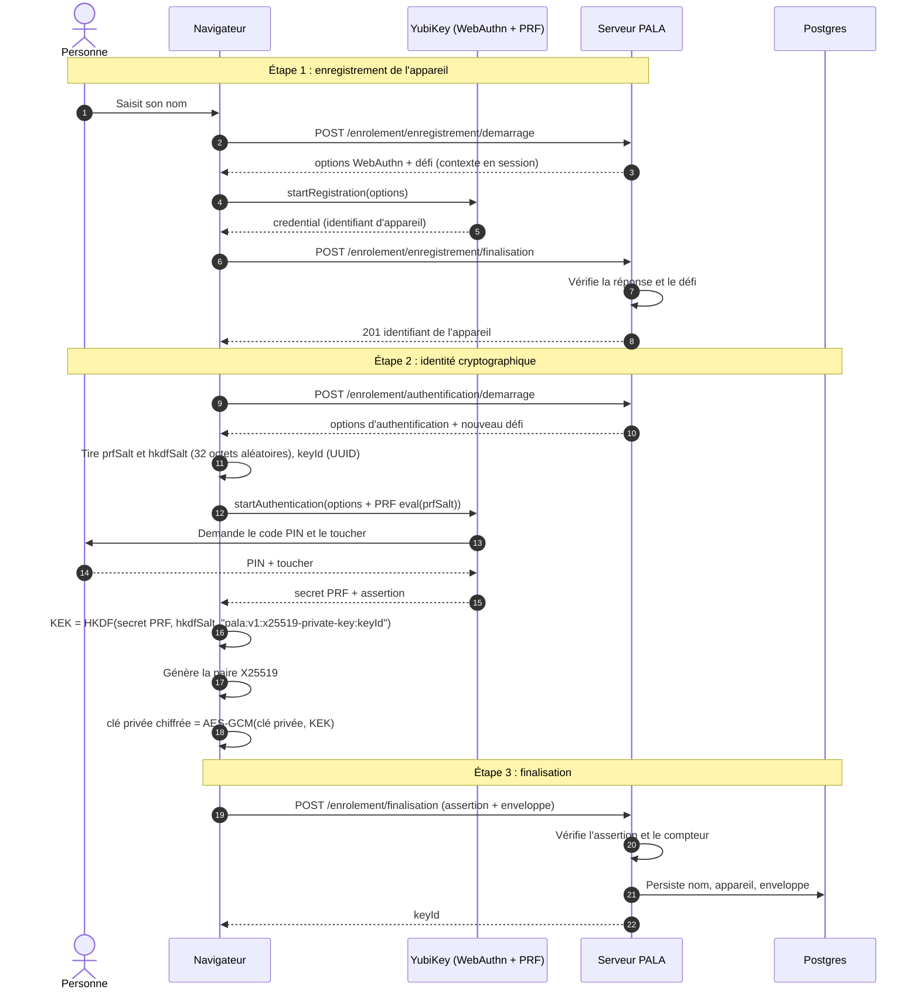

# Enrôlement d'un destinataire

L'enrôlement crée l'identité cryptographique d'une personne : une paire de clés X25519 dont la clé privée n'existe en clair que dans le navigateur. Elle est stockée chiffrée, et seule la YubiKey de la personne permet de la rouvrir (extension WebAuthn PRF).

L'enveloppe envoyée au serveur contient :

| Champ               | Contenu                                                                            |
| ------------------- | ---------------------------------------------------------------------------------- |
| `keyId`             | identifiant de la clé, lié à la KEK et aux enveloppes de rapport                   |
| `clePublique`       | clé publique X25519, utilisée par l'outillage pour chiffrer                        |
| `clePriveeChiffree` | clé privée chiffrée en AES-GCM par la KEK (`iv` + `ciphertext`)                    |
| `prf`               | `salt` PRF, `hkdfSalt` et version : de quoi redemander le même secret à la YubiKey |

## Qui peut déchiffrer ?

- **Le serveur et la base** détiennent la clé publique et la clé privée chiffrée, mais jamais la KEK : le secret PRF ne sort pas de la YubiKey. Ils ne peuvent pas ouvrir la clé privée.
- **La personne enrôlée** est la seule à pouvoir la rouvrir : il faut sa YubiKey physique, son code PIN et un geste de présence.
- Perdre la YubiKey fait perdre l'accès aux rapports chiffrés pour cette identité : il n'existe pas de recouvrement par le serveur.
- Un enrôlement ne donne accès qu'aux rapports chiffrés **après** lui (voir [le chiffrement](./chiffrement.md)).

## Code

- Cas d'usage `EnroleUtilisateur` : [`noyau-partage/src/chiffrement/application/EnroleUtilisateur.ts`](../../noyau-partage/src/chiffrement/application/EnroleUtilisateur.ts)
- Étapes côté navigateur : [`serveur/front/src/enrolement/etapesEnrolement.ts`](../../serveur/front/src/enrolement/etapesEnrolement.ts)
- Étapes et routes côté serveur : [`serveur/back/src/enrolement/etapesEnrolement.ts`](../../serveur/back/src/enrolement/etapesEnrolement.ts), [`serveur/back/src/http/routeEnrolement.ts`](../../serveur/back/src/http/routeEnrolement.ts)
